# Cubrí - Flujo de Contratación Digital de Seguros

Este proyecto es la implementación frontend de un flujo de contratación de seguros (checkout multipaso) para la materia Diseño UXUI (Licenciatura en Sistemas de Información, UADER). 

El usuario puede cotizar el seguro de su celular, elegir un plan, cargar sus datos personales, simular el pago y obtener un número de póliza generado dinámicamente.

## 🚀 Sitio Publicado
Puedes ver el proyecto funcionando en vivo aquí: 
**[https://tp-5-contratacion-seguros.netlify.app/]**

## 🛠️ Stack Tecnológico
- **HTML5** (Semántico)
- **CSS / Framework:** Tailwind CSS v4 (vía CDN)
- **Componentes:** Basecoat UI
- **Lógica:** JavaScript Vanilla (Modular: estado centralizado, render, validaciones e interacciones)

## ⚙️ Cómo correr el proyecto localmente
Al utilizar la opción "sin build" (CDN) para Tailwind y Basecoat UI, no es necesario compilar el código. Para correr el proyecto:
1. Clonar este repositorio.
2. Abrir el archivo `index.html` utilizando la extensión **Live Server** en Visual Studio Code (o cualquier servidor HTTP local). 
3. *Nota:* Es importante usar un servidor local en lugar de abrir el archivo directamente con doble clic (`file://`) para evitar problemas con las peticiones asíncronas (`fetch`) en caso de cargar datos externos en el futuro.

## 🧠 Decisiones Tomadas
- **Estado Centralizado:** Toda la información del usuario (marca, modelo, plan, datos personales) se almacena en un único objeto de estado en JavaScript. El DOM se actualiza leyendo siempre de esta "fuente de la verdad".
- **Validaciones Dinámicas y UX:** Se implementó validación en tiempo real para habilitar o bloquear los botones de avance de forma estricta, obligando al usuario a cumplir los requisitos de negocio (ej. el valor del celular entre $100.000 y $2.500.000).
- **Mobile First & Render Único:** El resumen del carrito se estructuró para compartir la lógica de actualización entre la vista Desktop (tarjeta lateral) y Mobile (barra superior o inferior), evitando duplicar código innecesario.
- **Simulación de Pago:** Se implementó el ruteo lógico para derivar al usuario a la pantalla de éxito o a la de error dependiendo estrictamente del número de tarjeta ingresado, con opción a reintento conservando los datos tipeados.

## 🌟 Bonus Implementados
- **Máscaras de input:** Se agregó lógica en JavaScript para formatear automáticamente el número de tarjeta (separado en grupos de 4) y el vencimiento (con barra automática `MM/AA`) mientras el usuario escribe.
- **Formateo de moneda:** Se aplicó `Intl.NumberFormat` para que el valor del equipo adquiera formato de moneda local dinámicamente al escribir.

## 📸 Capturas de Pantalla

### Versión Desktop (1440px)

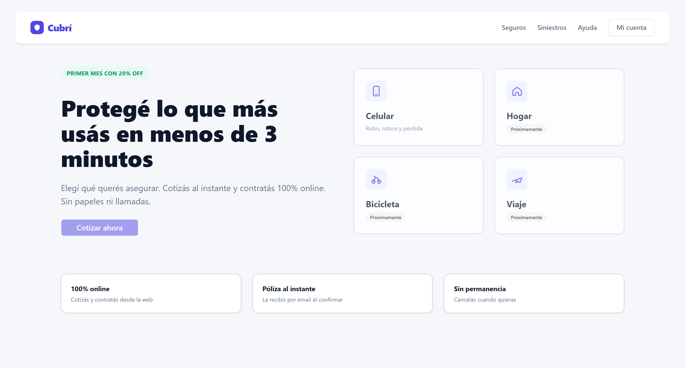
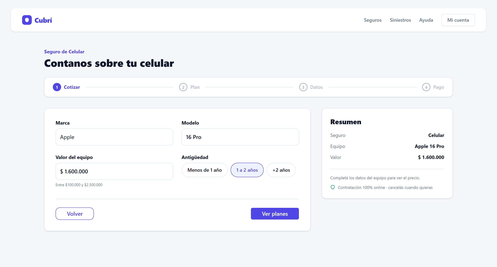
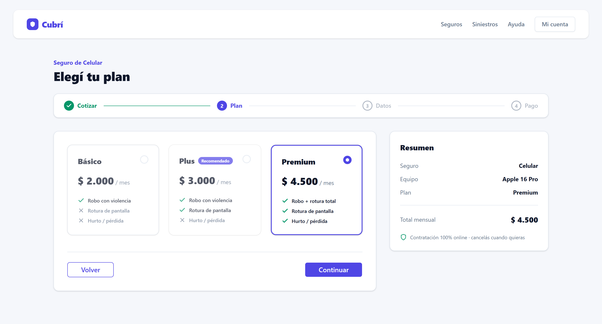
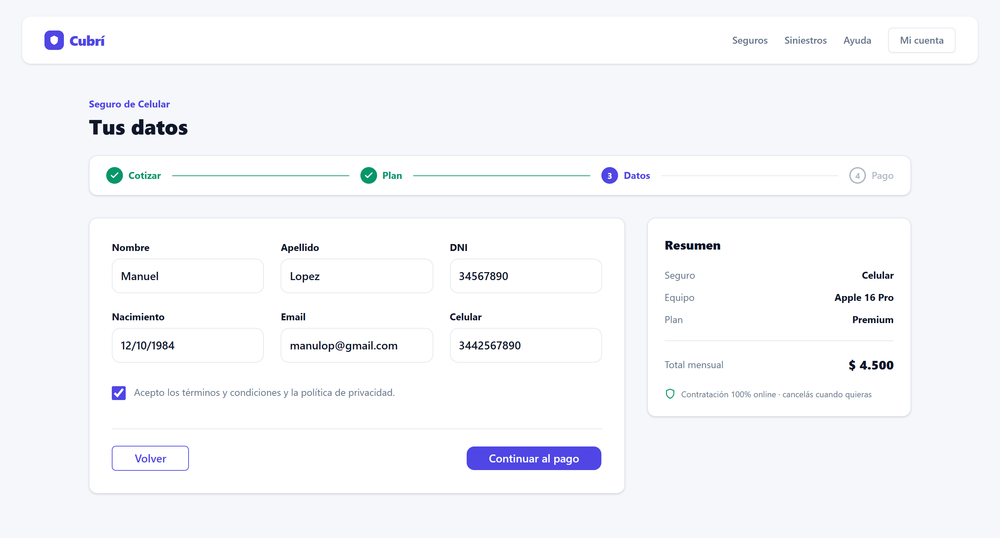
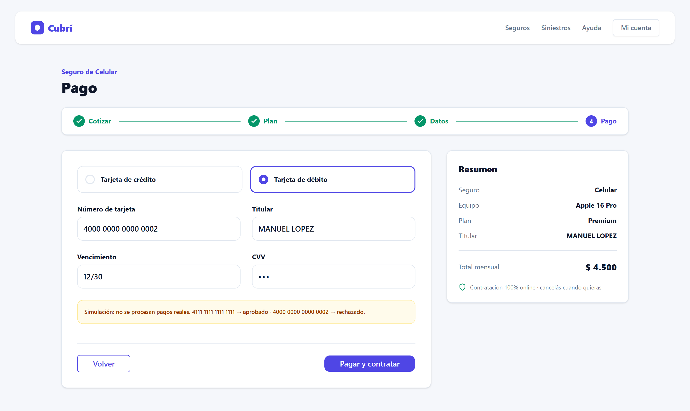
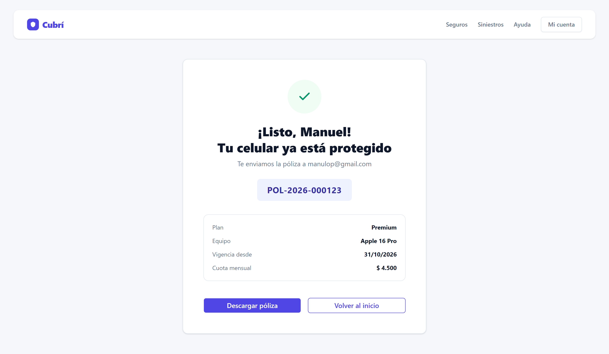
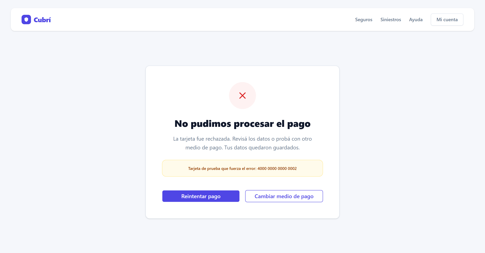

### Versión Mobile (390px)

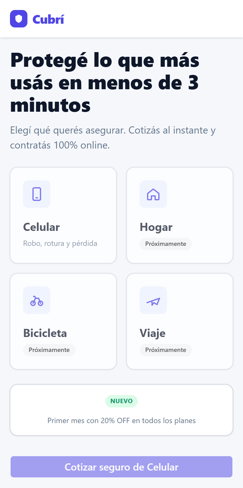
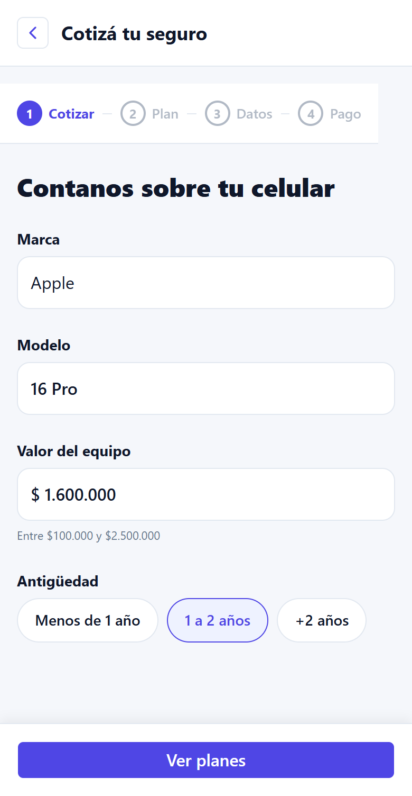
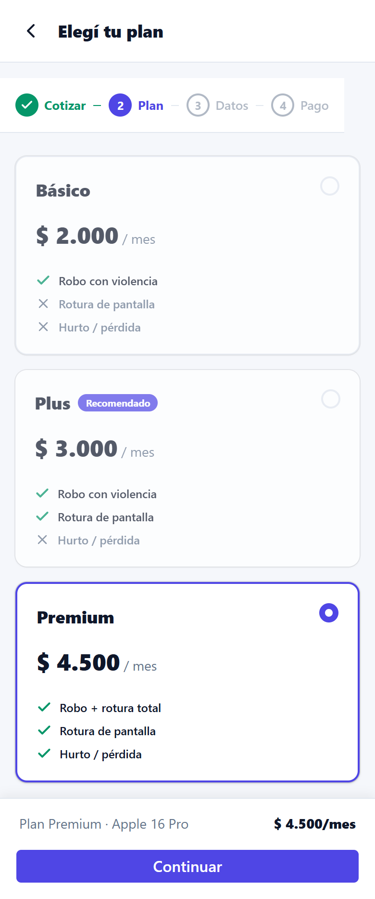
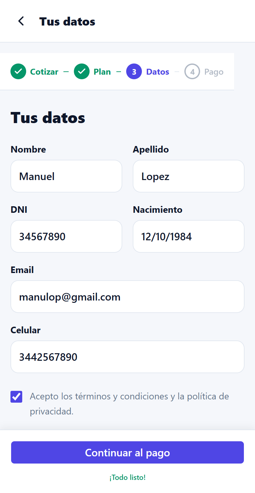
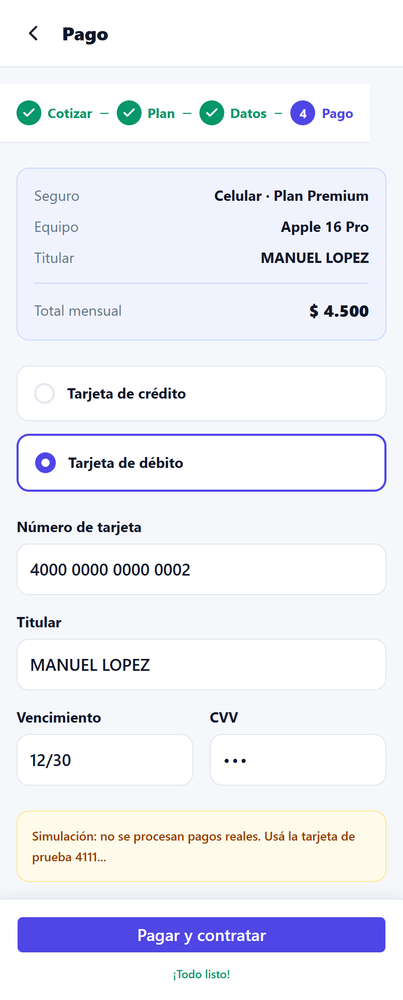
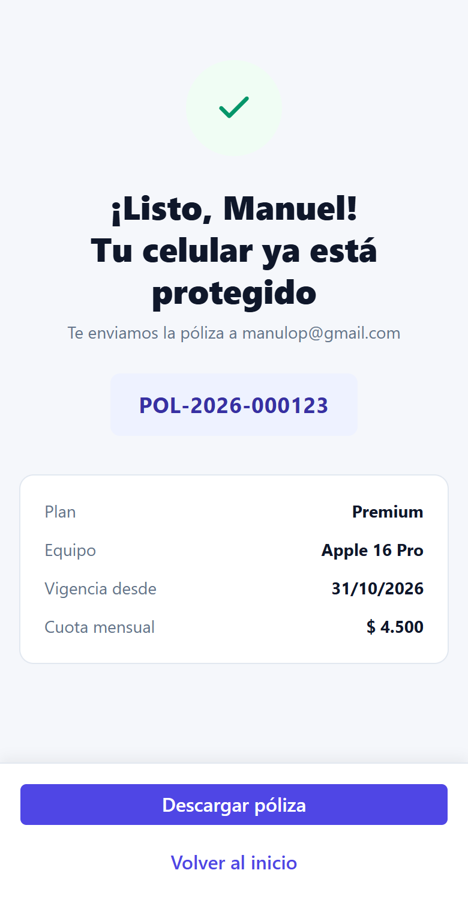
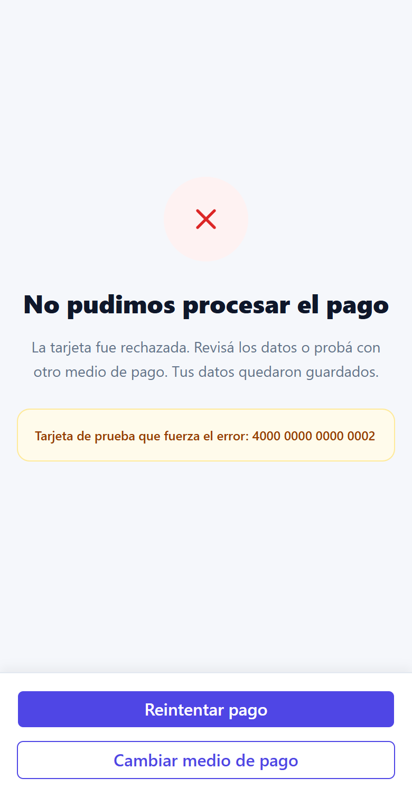